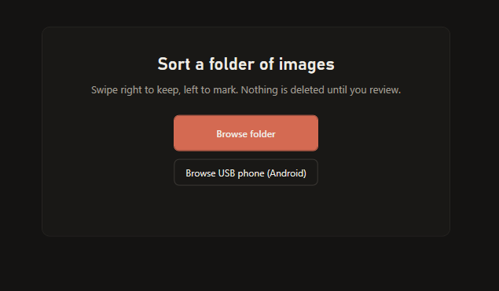
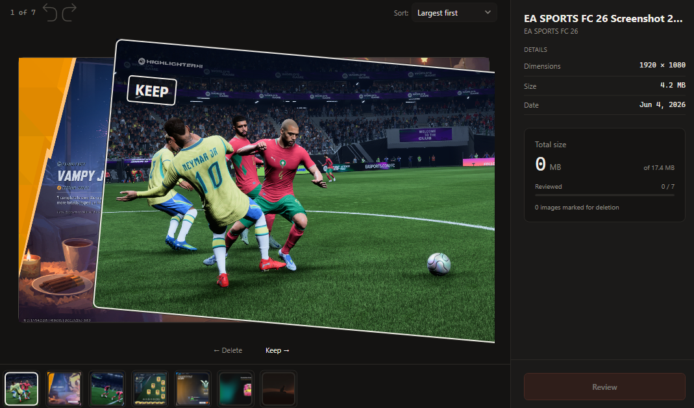
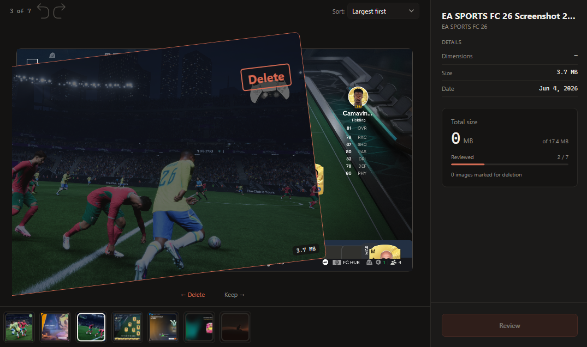
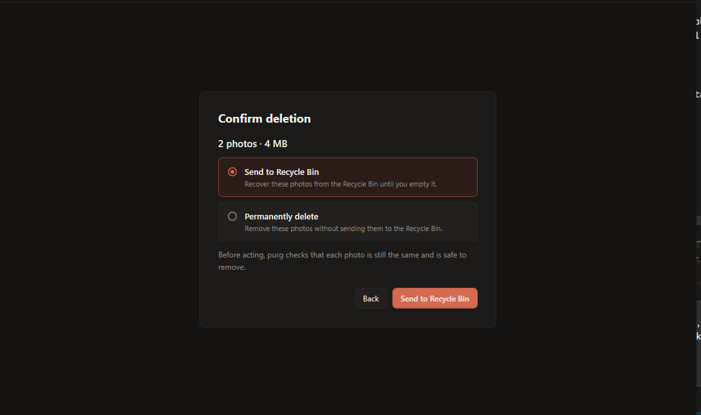

<div align="center">

# purg

**Make Cleaning Simple**

Open Source image cleaner for Windows. Swipe through a folder, decide in a second and review before anything is removed.


</div>

---

## What is purg?

Your Pictures folder, your screenshots, your phone's camera roll: they fill up with blurry shots, duplicates and things you dont need anymore. Cleaning them up one by one in File Explorer is slow and boring.

**purg** turns it into a swipe style process. Photos appear as cards. Press **→** to keep, **←** to mark for deletion ( or grab with the mouse ), and move on. When you are done, you review what you marked and confirm. Until then, **nothing on your disk changes.**

> **Alpha release.** purg is early software.

<div align="center">
  
</div>

## Screenshots

| Keep | Mark for deletion |
|---|---|
|  |  |

<div align="center">
  
</div>

## Features

- **Swipe-card review.** One photo at a time, with the next one stacked underneath and a filmstrip to jump around.
- **Keyboard and Mouse.** Go through hundreds of photos using only the arrow keys or with your mouse.
- **Undo and Redo.** Changed your mind? Step back as many times as you need.
- **Safe by default.** Marked photos go to the **Windows Recycle Bin**, so you can still restore them.
- **Review before anything happens.** A confirmation screen shows how many photos and how much space are involved.
- **Sort your way.** Largest first (great for freeing space), newest first, or by filename.
- **Photo details at a glance.** Name, dimensions, size, date and camera model when available.
- **Works on subfolders.** Point it at a folder and it checks everything inside.
- **USB Android phone support.** Browse a phone connected in File Transfer mode (see the note below).
- **Clear results.** See what was removed, skipped or failed, with plain-language reasons.

## Keyboard shortcuts

| Key | Action |
|---|---|
| **→** Right arrow | Keep |
| **←** Left arrow | Mark for deletion |
| **Backspace**, **Z** or **Ctrl+Z** | Undo |
| **Ctrl+Y** or **Ctrl+Shift+Z** | Redo |

## Getting started

### Requirements

- **Windows 10 (build 19041 or later) or Windows 11, 64-bit (x64)**
- **[.NET 10 Desktop Runtime (x64)](https://dotnet.microsoft.com/download/dotnet/10.0)**: if purg does not start, you most likely need to install this

### Install

purg is a single portable `.exe`. It is **not an installer** and does not change your system.

1. Go to the [**Releases**](../../releases) page and download the latest `Purg.exe`.
2. Install the .NET 10 Desktop Runtime if you do not have it yet.
3. Double-click `Purg.exe`.

### Use it

1. Click **Browse folder** or drag a folder into the window.
2. Swipe through your photos.
3. Click **Review** to see everything you marked.
4. Confirm. Marked photos are sent to the Recycle Bin or Permanently deleted.

## Your files are safe

purg is built to be careful with your photos.

- **Swiping only records a decision.** Files are not touched until you review and confirm.
- **Recycle Bin by default.** You can restore photos until you empty it. Permanent deletion is a separate choice with a clear warning and a second confirmation.
- **Double-checks before acting.** Just before removing a file, purg checks that it still exists and has not changed since you saw it.
- **Skips risky locations.** It will not run on network drives, drive roots or protected Windows folders, and it skips hidden or system files and cloud-only placeholders.
- **Not a gallery or backup tool.** purg does not edit photos, upload them or back them up.

> purg does not free disk space on its own when using the Recycle Bin. Empty the Recycle Bin to reclaim the space.

## Privacy

- **Works offline.** No network connections and no update checks.
- **No traces.** No image cache or temporary image files are written to disk, and purg does not remember which folders you opened.

## Using an Android phone over USB

You can clean up a phone's camera roll straight from your PC. Connect the phone by USB, set it to **File Transfer** mode, then choose **Browse USB phone (Android)** on the start screen.

- Deleting from a phone is **permanent**. It never goes through the Windows Recycle Bin, so purg shows an extra warning and asks for a second confirmation.
- This feature is **new and has not yet been tested on a wide range of real phones.** Treat it as experimental.

## Supported image formats

| Support | Formats |
|---|---|
| Fully supported | JPG, JPEG, PNG, WebP, BMP, GIF, TIFF, AVIF, HEIC, HEIF, ICO, JXR |
| Needs a Windows codec | Some WebP, AVIF, HEIC and HEIF files may need an optional codec from Microsoft. If a preview is unavailable, you can still keep or delete the file. |
| Not supported | RAW camera files, SVG, EPS, PDF |

## Known limitations

- Alpha software: behaviour and features may change between versions.
- Windows x64 only.
- Requires the .NET 10 Desktop Runtime (the `.exe` is not self-contained yet).
- Android phone support is experimental and not verified on every device.
- Very large images are not previewed (over about 40 megapixels for JPEG and 12 megapixels for other formats), but you can still decide on them.

## Roadmap

Ideas for future versions (none of these are promises):

- [ ] Self-contained build and a proper installer, so no separate runtime is needed
- [ ] Verified Android phone support across more devices
- [ ] RAW photo support
- [ ] More sorting and filtering options
- [ ] Support for more optional codecs out of the box
- [ ] Customizable keyboard shortcuts

Have an idea? [Open an issue](../../issues).

## Under the hood

Structure and code

- **WPF desktop app** built with **.NET 10** and **no third-party runtime packages**
- **Clean separation of concerns:** UI, session state (Undo/Redo), scanning, image decoding, platform access and file operations each live in their own project
- **One narrow gate for destructive actions:** every file removal goes through a single constrained component, `Purg.Mover`
- **Bounded memory use:** only a handful of decoded images are kept in memory at a time
- **Tested:** unit tests plus an automated check that guards the safety and privacy rules

```
src/
  Purg.App       WPF screens and app startup
  Purg.Session   Image state and Undo/Redo history
  Purg.Scan      Local and phone folder scanning
  Purg.Decode    Image decoding and frame cache
  Purg.Platform  Path validation, file identity, Windows Portable Devices
  Purg.Mover     The only place files are moved or deleted
tests/
  Purg.Tests     Automated tests
tools/
  ci-checks.ps1  Safety and privacy boundary checks
```

### Build from source

You will need the .NET 10 SDK on Windows.

```powershell
dotnet test .\Purg.sln -c Release
.\tools\ci-checks.ps1
```

## Feedback

Found a bug or have a suggestion? Please [open an issue](../../issues). Since purg is in alpha, bug reports are especially welcome.

## License

Released under the [MIT License](LICENSE).
